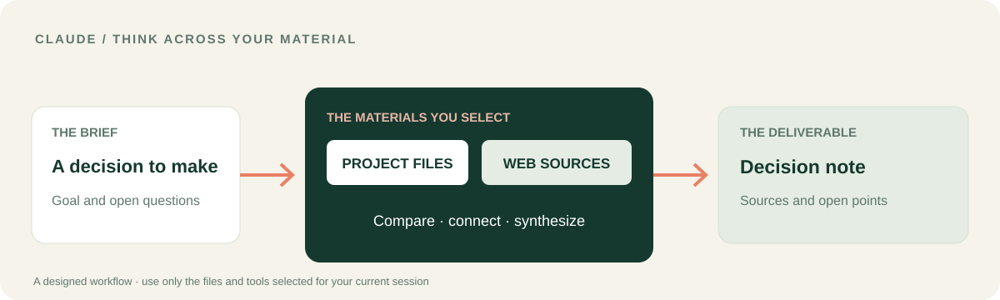

# LUCH for Claude
### Turn scattered material into a decision you can explain.

I built this Claude integration so reasoning can reach the materials behind it. **LUCH brings the selected sources and tools around your work into the conversation** — so the answer can become a comparison, a decision brief or a draft grounded in material you can inspect.

[**See the Claude workflow**](docs/CLAUDE_WORKFLOW.md) · [**Connect in Claude**](#bring-luch-into-claude) · [Русский](README.ru.md) · [LUCH platform](https://github.com/lenar2/luch)

## A Claude workflow: from a project brief to a clear decision

You have a project with several moving parts. Two approved documents describe the current situation; public sources add context. You want to know what agrees, what conflicts and what deserves a decision.

1. Give Claude the question and identify the exact files or folders you want it to use.
2. Ask it to read those approved materials and compare them with the public sources relevant to the question.
3. Have Claude separate facts, differences and open questions.
4. Review a concise decision note with source references. If you want a file saved, choose the destination and approve that write separately.

**The result is not another chat summary:** it is a structured view of the material behind the decision, with the sources still visible.

[**Open the step-by-step workflow →**](docs/CLAUDE_WORKFLOW.md)

## What Claude gets from LUCH

| Capability | What it adds to Claude |
| --- | --- |
| **Browser and tabs** | Read permitted public pages, inspect page content and use a user-authorized tab when that is the right route |
| **Files** | Find, read and — when allowed — edit selected files, preserve originals and verify the change |
| **Server** | Run bounded diagnostics on the exact server you selected |
| **Computer** | Use a paired desktop only when the host exposes the required controls and the device is online |
| **Workflows and safety** | Coordinate multiple steps, verify observable results and keep consequential actions under your approval |

The public plugin contains 12 skills that describe these workflows. The tools available in a live session are determined by the current Claude host, your LUCH account and the permissions you grant.

## Bring LUCH into Claude

1. Open this repository and use Claude's supported plugin installation flow for the `.claude-plugin/plugin.json` manifest.
2. Complete the host-managed OAuth connection for your own LUCH account, if prompted.
3. Ask Claude to list the LUCH tools it can actually see.
4. Begin with a read-only task: *“Compare these two documents in my approved project folder. Cite the source of every difference.”*

[Plugin manifest](.claude-plugin/plugin.json) · [MCP configuration](.mcp.json) · [Technical setup](https://luch.lenarsalimov.ru/docs/get-started/)

## Keep the work yours

You choose the material, the device and the scope. Claude can prepare a draft or proposed change; saving, publishing or making an external change remains a separate decision.

I already use LUCH for real work in my own connected environment. The public plugin source is available to inspect; account activation and host-specific onboarding are separate from installing the package. See [service status](https://luch.lenarsalimov.ru/en/status/) and [support](https://luch.lenarsalimov.ru/support/).

For developers and reviewers

- 12 skills: browser, local browser, tabs, files, computer, server, services, control, safety, capabilities, troubleshooting and workflows.
- Public client version: v0.1.6. The hosted service has its own lifecycle.
- [My documented LUCH workflow](https://github.com/lenar2/luch/blob/main/docs/REAL_WORK.md) demonstrates actual work through connected tools; it is not a claim that Claude executed that specific case.
- [Release gates](docs/PUBLIC_RELEASE_GATES.md) · [Safety](SECURITY.md) · [Apache-2.0](LICENSE).

