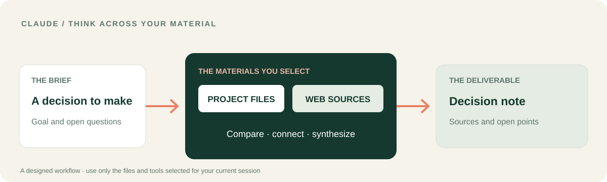

# LUCH для Claude
### Соедините разрозненные материалы в решение, которое можно объяснить.

Я создал эту интеграцию с Claude, чтобы рассуждение опиралось на реальные материалы. **LUCH подключает к этой работе выбранные источники и инструменты** — чтобы ответ превратился в сравнение, записку для решения или черновик, основанный на материалах, которые можно проверить.

[**Посмотреть сценарий Claude**](docs/CLAUDE_WORKFLOW.ru.md) · [**Подключить Claude**](#подключение-к-claude) · [English](README.md) · [Платформа LUCH](https://github.com/lenar2/luch)

## Сценарий Claude: от задачи проекта к ясному решению

У вас проект с несколькими источниками. Два документа описывают текущую ситуацию, а публичные материалы добавляют контекст. Нужно понять, что совпадает, где противоречия и что требует решения.

1. Сформулируйте вопрос Claude и укажите точные файлы или папки, которые можно использовать.
2. Попросите прочитать разрешённые материалы и сопоставить их с публичными источниками по теме.
3. Отделите факты, расхождения и открытые вопросы.
4. Получите краткую записку с указанием источников. Если хотите сохранить её в файл, отдельно выберите место и разрешите запись.

**Результат — не ещё один пересказ чата:** это структурированная картина материалов, на которых основано решение, с видимыми источниками.

[**Подробный сценарий по шагам →**](docs/CLAUDE_WORKFLOW.ru.md)

## Что LUCH добавляет к Claude

| Возможность | Что она даёт |
| --- | --- |
| **Браузер и вкладки** | Читать разрешённые публичные страницы и работать с вкладкой, к которой вы дали доступ |
| **Файлы** | Находить и читать выбранные файлы, а при разрешении — редактировать и проверять изменения |
| **Сервер** | Запускать ограниченную диагностику на точно выбранном сервере |
| **Компьютер** | Работать с подключённым компьютером, только если клиент видит нужные инструменты и устройство онлайн |
| **Сценарии и безопасность** | Проводить несколько этапов, проверять результат и оставлять важные действия под вашим контролем |

В открытом плагине — 12 навыков, описывающих эти сценарии. Фактический набор инструментов зависит от Claude, аккаунта LUCH и выданных разрешений.

## Весь LUCH — не только этот сценарий

Я создаю одну связанную систему, а не четыре разрозненных плагина. Помимо работы с документами, 12 открытых навыков LUCH описывают **изолированный браузер, отдельный разрешённый локальный браузер, вкладки, файлы, управление подключённым компьютером, серверы, поддерживаемые сервисы, сложные задачи, обнаружение инструментов, маршрутизацию, безопасность и диагностику**.

[**Полная карта возможностей LUCH →**](https://github.com/lenar2/luch/blob/main/docs/CAPABILITIES.ru.md)

Конкретный Claude-клиент использует только те инструменты, устройства и разрешения, которые доступны ему в текущей сессии.
## Подключение к Claude

1. Откройте репозиторий и используйте штатный механизм установки плагинов Claude для манифеста `.claude-plugin/plugin.json`.
2. Если появится запрос, пройдите OAuth через саму платформу и свой аккаунт LUCH.
3. Попросите Claude показать инструменты LUCH, которые действительно доступны в текущей сессии.
4. Начните с чтения: *«Сравни два документа в разрешённой папке проекта. Для каждого различия укажи источник».*

[Манифест плагина](.claude-plugin/plugin.json) · [MCP-конфигурация](.mcp.json) · [Техническая инструкция](https://luch.lenarsalimov.ru/docs/get-started/)

## Решение остаётся за вами

Вы выбираете материалы, устройство и границы доступа. Claude может подготовить черновик или предложить изменение; сохранение, публикация и внешние действия требуют отдельного решения.

Я уже использую LUCH для реальной работы в собственной подключённой среде. Исходники плагина открыты; активация аккаунта и подключение конкретной платформы — отдельные шаги. [Статус сервиса](https://luch.lenarsalimov.ru/ru/status/) · [Поддержка](https://luch.lenarsalimov.ru/support/)

Разработчикам и проверяющим

- 12 навыков: браузер, локальный браузер, вкладки, файлы, компьютер, сервер, сервисы, управление, безопасность, возможности, диагностика и сценарии.
- Версия клиентского пакета: v0.1.6. У размещённого сервиса свой жизненный цикл.
- [Мой документированный сценарий LUCH](https://github.com/lenar2/luch/blob/main/docs/REAL_WORK.ru.md) показывает работу через подключённые инструменты, но не утверждает, что именно Claude выполнил эту задачу.
- [Критерии выпуска](docs/PUBLIC_RELEASE_GATES.md) · [Безопасность](SECURITY.md) · [Apache-2.0](LICENSE).

