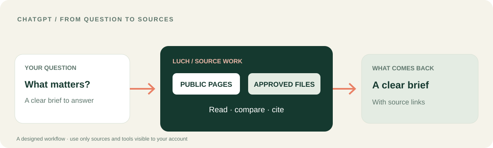

<p></p>

# LUCH for ChatGPT
### Turn a question into a sourced brief — then decide what to do.

ChatGPT is where you shape the question. **LUCH can bring selected web and connected resources into the work**, so the conversation can return with sources, comparisons and a result you can inspect.

[**See the ChatGPT workflow**](CHATGPT_WORKFLOW.md) · [**Package and setup**](#connect-the-chatgpt-candidate) · [Русский](README.ru.md) · [LUCH platform](https://github.com/lenar2/luch)



## A ChatGPT workflow: from a question to a useful brief

You need to understand a topic before making a decision.

1. Ask ChatGPT to investigate a specific question.
2. Use the LUCH browser route to read the public pages relevant to that question, when that tool is exposed to your session.
3. If your account has an approved file connection, bring in the selected documents as well.
4. Ask for a comparison that separates what each source says, where they agree and what remains uncertain.
5. Get a concise brief with source links and a clear next question.

**What changes:** the conversation is connected to the material behind the answer. You can open the sources, inspect the summary and decide what happens next.

[**Open the step-by-step workflow →**](CHATGPT_WORKFLOW.md)

## What the ChatGPT candidate contains

- A portable plugin manifest and remote MCP configuration.
- Twelve LUCH skills for browser, files, connected resources, safety and multi-step workflows.
- Example prompts for discovering the tools available to the current account and starting with a read-only task.
- A package builder for the public v0.1.6 preview.

## Connect the ChatGPT candidate

1. Build the package from the parent repository root:

```bash
python3 integrations/chatgpt/build_package.py
```

2. Inspect the generated `dist/luch-chatgpt-0.1.6-preview.zip`.
3. Use the supported ChatGPT plugin connection and OAuth flow if it is available to your account.
4. Ask ChatGPT to show the LUCH tools it can actually see, then try a read-only public-page summary.

[Plugin manifest](plugin.json) · [MCP configuration](mcp.json) · [Build script](build_package.py)

## Your conversation. Your sources. Your next move.

LUCH is used for real work in the founder's connected environment. This public ChatGPT package is a candidate for evaluation; it is not represented as an approved OpenAI Directory listing. Account access and host availability are separate from building or downloading the package.

The founder's [documented LUCH outcome](https://github.com/lenar2/luch/blob/main/docs/REAL_WORK.md) shows the broader product in action. It is not presented as a ChatGPT-specific execution test.

[Service status](https://luch.lenarsalimov.ru/en/status/) · [Support](https://luch.lenarsalimov.ru/support/) · [Privacy](https://luch.lenarsalimov.ru/privacy/)

<details><summary>For integration reviewers</summary>

The portable package is v0.1.6 and contains no credentials. The founder's private ChatGPT installation (v0.3.51) is a separate environment and is not replaced by this candidate.

Before a public directory submission, a new non-owner user must complete OAuth, discover the actual tools, perform an authorized read-only task, receive denial on an unapproved resource, and verify revocation. These are distinct acceptance tests; package generation is not a substitute.

[OpenAI plugin guidance](https://developers.openai.com/plugins/build/plugins) · [Submission guidance](https://developers.openai.com/plugins/deploy/submission) · [Security](https://luch.lenarsalimov.ru/en/safety/)

</details>
