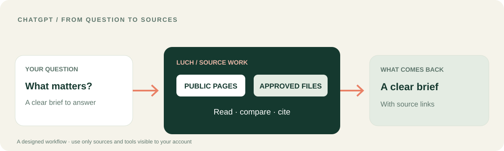

<p></p>

# LUCH для ChatGPT
### Превратите вопрос в справку с источниками — и решайте, что делать дальше.

ChatGPT помогает сформулировать вопрос. **LUCH может подключить к работе выбранные веб-страницы и разрешённые ресурсы**, чтобы в разговоре появились источники, сравнения и результат, который можно проверить.

[**Сценарий ChatGPT**](CHATGPT_WORKFLOW.ru.md) · [**Пакет и подключение**](#подключение-кандидата-chatgpt) · [English](README.md) · [Платформа LUCH](https://github.com/lenar2/luch)



## Сценарий ChatGPT: от вопроса к полезной справке

Перед решением нужно разобраться в теме.

1. Сформулируйте ChatGPT конкретный вопрос для исследования.
2. Если инструмент доступен в текущей сессии, попросите LUCH прочитать публичные страницы по теме.
3. Если у аккаунта подключены разрешённые файлы, добавьте выбранные документы.
4. Попросите сравнить источники: что говорит каждый, в чём они совпадают и что осталось неизвестным.
5. Получите короткую справку со ссылками и понятным следующим вопросом.

**Что меняется:** разговор опирается на материалы, из которых складывается ответ. Вы можете открыть источники, проверить выводы и сами решить, что делать дальше.

[**Подробный сценарий →**](CHATGPT_WORKFLOW.ru.md)

## Что входит в кандидат ChatGPT

- Переносимый манифест плагина и конфигурация удалённого MCP.
- Двенадцать навыков LUCH для браузера, файлов, подключённых ресурсов, безопасности и многоэтапных задач.
- Примеры запросов для проверки доступных инструментов и начала с чтения.
- Сборщик публичного preview-пакета v0.1.6.

## Подключение кандидата ChatGPT

1. Соберите пакет из корня родительского репозитория:

```bash
python3 integrations/chatgpt/build_package.py
```

2. Проверьте созданный файл `dist/luch-chatgpt-0.1.6-preview.zip`.
3. Используйте штатный механизм подключения плагинов ChatGPT и OAuth, если он доступен вашему аккаунту.
4. Попросите ChatGPT показать фактически доступные инструменты LUCH и начните с чтения публичной страницы.

[Манифест плагина](plugin.json) · [MCP-конфигурация](mcp.json) · [Сборщик пакета](build_package.py)

## Ваш разговор. Ваши источники. Ваш следующий шаг.

LUCH используется для реальной работы в подключённой среде основателя. Публичный пакет ChatGPT — кандидат для оценки; он не представлен как одобренная публикация в OpenAI Directory. Доступ к аккаунту и поддержка платформы не возникают автоматически при сборке или загрузке пакета.

[Документированный результат LUCH в среде основателя](https://github.com/lenar2/luch/blob/main/docs/REAL_WORK.ru.md) показывает более широкий продукт. Это не выдаётся за отдельный тест интеграции ChatGPT.

[Статус сервиса](https://luch.lenarsalimov.ru/ru/status/) · [Поддержка](https://luch.lenarsalimov.ru/support/) · [Конфиденциальность](https://luch.lenarsalimov.ru/privacy/)

<details><summary>Для проверяющих интеграцию</summary>

Переносимый пакет v0.1.6 не содержит учётных данных. Частная установка основателя ChatGPT версии 0.3.51 — отдельная среда, этот кандидат её не заменяет.

Перед публичной подачей новый пользователь не из числа владельцев должен пройти OAuth, увидеть фактические инструменты, выполнить разрешённую задачу чтения, получить отказ на неразрешённом ресурсе и проверить отзыв доступа. Сборка пакета не заменяет эти проверки.

[Документация OpenAI по плагинам](https://developers.openai.com/plugins/build/plugins) · [Подача в каталог](https://developers.openai.com/plugins/deploy/submission) · [Безопасность](https://luch.lenarsalimov.ru/ru/safety/)

</details>
